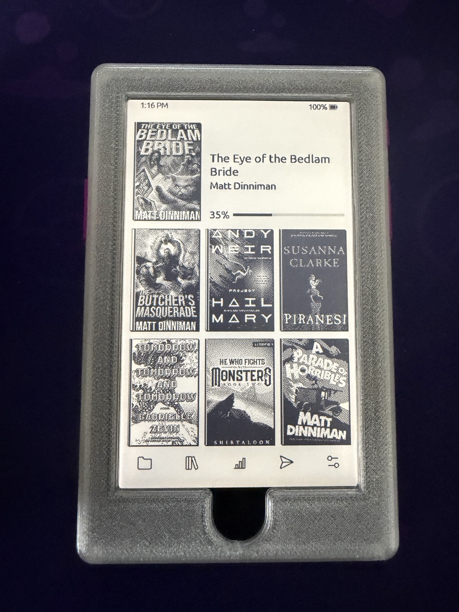
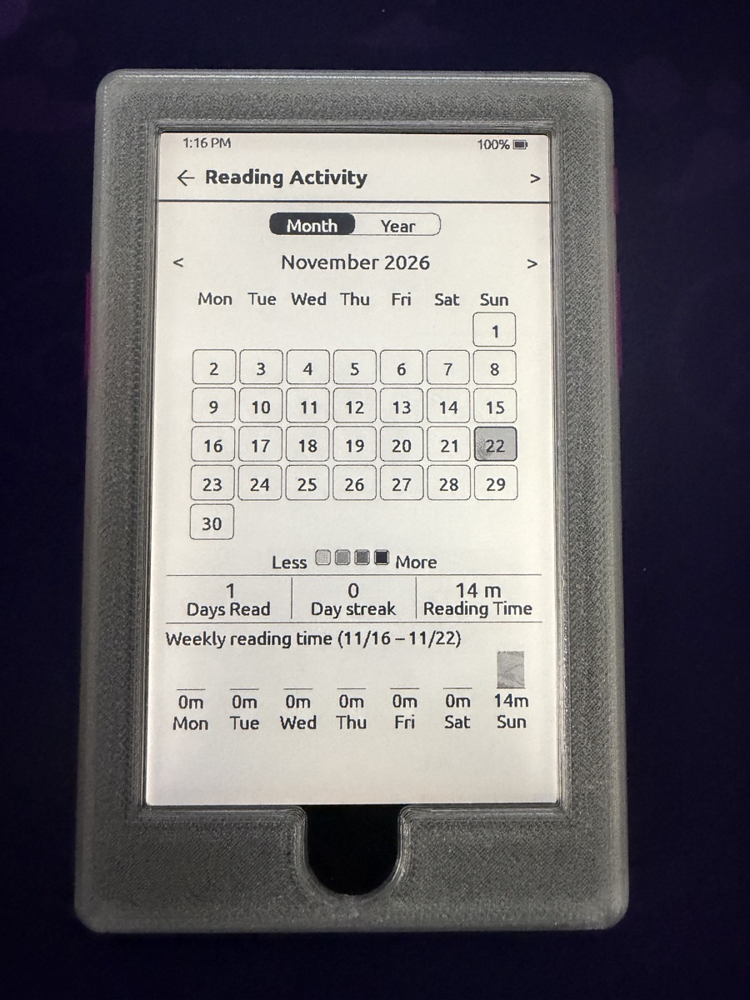
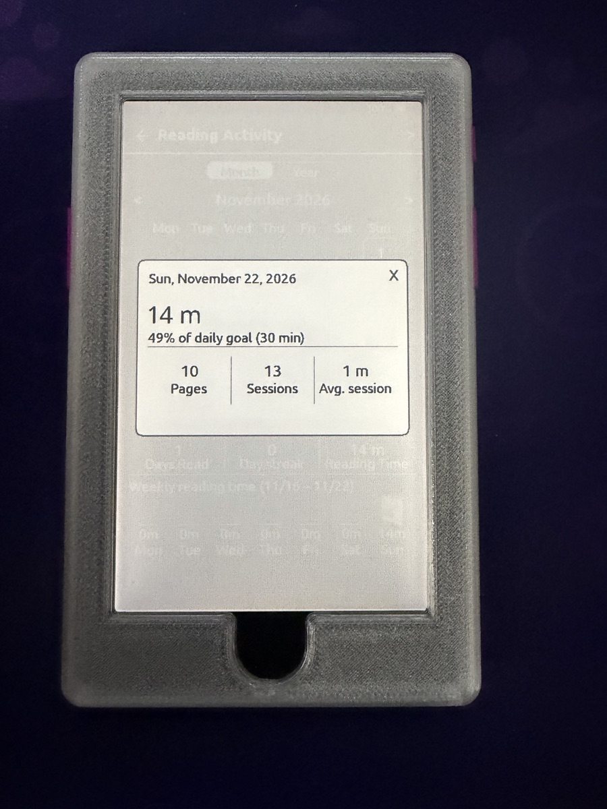
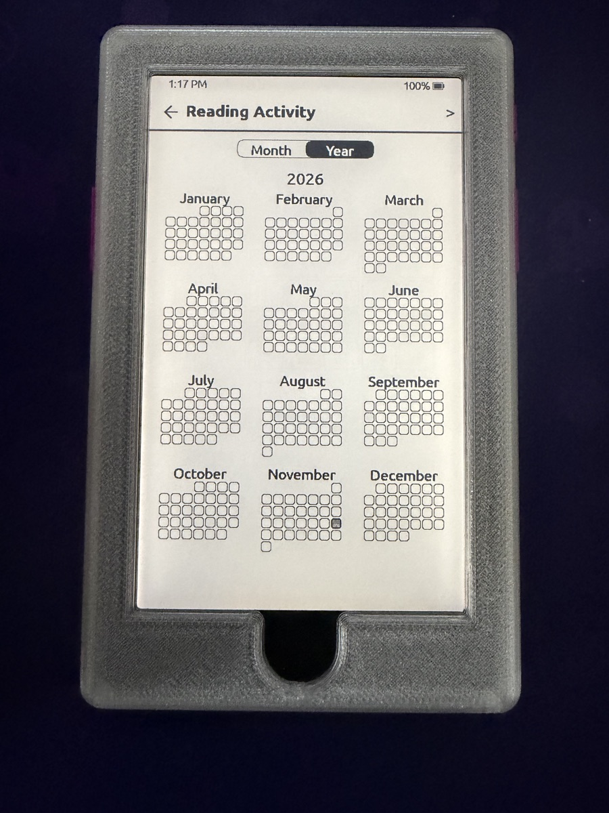
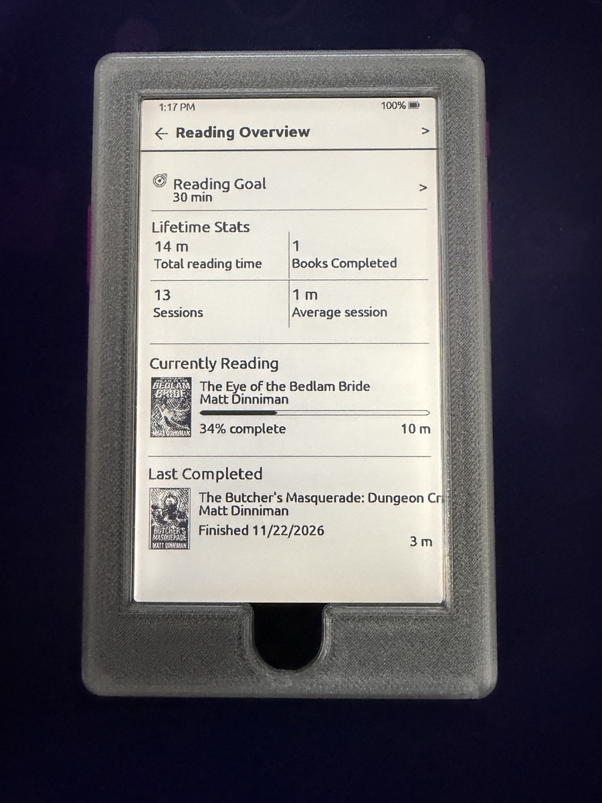

# CrossPoint Plus

This is my personal build of [CrossPoint Reader](https://github.com/crosspoint-reader/crosspoint-reader). I added the reading and light controls I wanted on my own devices. It is a community project, not an official CrossPoint release.

## What I changed

- Ruled paper lines you can turn on and adjust while reading. Choose solid or dotted lines and change their spacing and length. The lines stay out of chapter headings.
- Reading stats with a monthly activity calendar, year view, daily reading details, weekly reading-time chart, and adjustable daily goal. The overview shows lifetime reading totals, the current book, and the last completed book. Open stats from the Home Screen shortcut; on button-only devices, use the physical controls to move through dates and open a day or month.
- A quick sleep screen that appears before the rest of the sleep work finishes.
- A frontlight schedule that follows local time. Set when the light should turn off and when it should turn back on. On the Picco, the schedule controls the light by default. At a cold boot, an ON switch during scheduled-off hours turns it on; moving the switch during either schedule window overrides the light until the next schedule change. On devices using a button for the light, turning it on during scheduled-off hours keeps it on through sleep and shows a five-second reminder on wake. Turning it off during scheduled-on hours lasts until the next sleep wake, when the schedule turns it back on.

### Reading stats

<table>
  <tr>
    <td align="center"> Home Screen shortcut</td>
    <td align="center"> Monthly activity</td>
  </tr>
  <tr>
    <td align="center"> Daily details</td>
    <td align="center"> Year view</td>
  </tr>
  <tr>
    <td align="center"> Reading overview</td>
  </tr>
</table>

Reading stats sync through the configured CrossPoint Sync account during a normal CrossPoint Sync operation. Measured reader sessions are saved locally first and stay queued until the server acknowledges them, so a temporary network failure does not discard them. The server combines the account’s activity across devices; each device’s daily goal setting remains local.

The stat labeled **Pages** means estimated print pages progressed through, not physical screen turns. CrossPoint Sync derives it from forward progress changes and a known print-edition page count, then combines progress across devices without counting overlapping progress twice. The calendar’s daily Pages value counts new forward progress for that day. This gives a useful cross-device number even though devices do not share reliable turn-by-turn page counts; days without a known page count may not contribute.

Daily session counts and reading time are refreshed from the account’s exported reading history. That history can include measured sessions and, for sources that only report progress or daily totals, server-generated estimates. As a result, session counts can represent account history entries rather than a literal count of times the reader was opened.

## Devices

I have tested the firmware on my own **X3/X4, X4 Pro, and Picco**. Builds for all eight device profiles currently supported by this project completed successfully; the other five still need testing on the actual devices.

| Build | Status |
| --- | --- |
| X3 / X4 | Tested |
| X4 Pro | Tested |
| Picco | Tested |
| reTerminal Sticky | Build checked; needs device testing |
| X4 Classic | Build checked; needs device testing |
| M5PaperMono | Build checked; needs device testing |
| Metalio E-Ink 4 | Build checked; needs device testing |
| EEGOREAD A4 | Build checked; needs device testing |

## Getting started

For general setup, supported formats, buttons, and installation help, start with the [CrossPoint Reader user guide](https://github.com/crosspoint-reader/crosspoint-reader/blob/develop/USER_GUIDE.md). This fork follows CrossPoint's open-source license and keeps its original project history.

Test builds are available in the repository’s [Releases](https://github.com/ImGooseI/crosspoint-reader/releases) tab.
